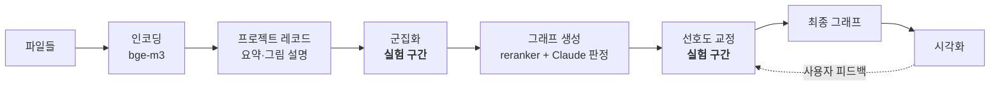

# ProjectLens

로컬 프로젝트 폴더(논문·코드·노트·그림)를 원문 근거가 달린 관계 그래프로 정리하는 파이프라인입니다. 사용자의 교정은 다음 생성에도 반영됩니다. KAIST AI618 Team 04 텀 프로젝트의 공통 베이스라인입니다.

- **구조**: 11/05 팀 회의에서 정한 파이프라인입니다. 군집화와 선호도 교정은 **실험 구간**이라 각자 방법을 끼워 넣어 비교하고, 나머지는 공통 코드입니다.
- **문서**: 구현 상세는 [docs/ARCHITECTURE.md](docs/ARCHITECTURE.md), 방법 추가 절차는 [CONTRIBUTING.md](CONTRIBUTING.md)를 보세요.



| 단계 | 구현 | 사용 모델 |
|---|---|---|
| 1 파일 입력 | PDF, Markdown, Python, Jupyter, 텍스트, SVG를 근거 조각으로 분할하고 import·링크를 추출 | PyMuPDF, Python AST |
| 2 인코딩 | 근거 조각과 요약 임베딩 (캐시) | **bge-m3** |
| 3 프로젝트 레코드 | 파일 요약·역할, 이미지 설명 | **Claude Haiku 5.5**, **Claude Sonnet 5.5** |
| 4 군집화 🧪 | `pref`: 중요 파일·쌍 1–5 평가·객관식 가이드 (회의안) / `baseline`: 선호 미반영 | bge-m3 벡터 + 계층 군집, 그룹 이름은 Haiku 5.5 |
| 5 그래프 생성 | 후보 연결(import·링크·파일명 언급·유사도), 근거 쌍 선택, 관계 판정·방향·직접/추론·인용 검증 | **bge-reranker-v2-m3**, **Claude Sonnet 5.5** |
| 6 선호도 교정 🧪 | `drift`: 커널 끌림/밀어냄, 학습 없음 (회의 4안) / `baseline`: 일반화 없음 | bge-m3 벡터 |
| 7 최종 그래프 | 교정 제안과 사용자의 직접 편집(항상 우선, 매번 다시 적용)을 합침 | |
| 8 시각화 | HTML 뷰어(근거 보기·교정·피드백 내보내기), Obsidian 볼트 내보내기 | vis-network |

## 설치

필요한 것:

- Python 3.11과 conda(Miniconda/Anaconda). conda가 없으면 스크립트가 `.venv`를 만듭니다.
- NVIDIA GPU 권장. CPU나 Apple MPS에서도 돌지만 느립니다.
- 디스크 약 10GB (PyTorch와 모델 4.5GB)
- Claude API 키. 없으면 `--no-llm`으로 Claude 단계를 빼고 돌릴 수 있습니다.

### 한 번에 설치 (권장)

```bash
git clone git@github.com:mumbumble/projectlens.git && cd projectlens
bash scripts/setup.sh          # Linux / WSL / macOS   (GPU가 없으면 --cpu)
```

```powershell
# Windows PowerShell, conda를 쓸 수 있는 터미널에서
powershell -ExecutionPolicy Bypass -File scripts\setup.ps1     # GPU가 없으면 -Cpu
```

스크립트는 다음을 순서대로 합니다.

1. conda env `projectlens`(Python 3.11)를 만듭니다.
2. 이 컴퓨터에 맞는 PyTorch 2.7.1을 설치합니다. NVIDIA GPU가 있으면 CUDA 12.6 버전입니다.
3. `requirements-dev.txt`를 설치합니다 (버전 고정).
4. 패키지를 설치합니다 (`pip install -e .`).
5. 모델 두 개를 받습니다.
6. 테스트와 `projectlens doctor`를 실행합니다.

### 직접 설치

```bash
conda create -n projectlens python=3.11 -y && conda activate projectlens
pip install torch==2.7.1 --index-url https://download.pytorch.org/whl/cu126   # NVIDIA GPU
# pip install torch==2.7.1                                                    # macOS / CPU
pip install -r requirements-dev.txt
pip install -e . --no-deps
python scripts/download_models.py      # bge-m3, bge-reranker-v2-m3 (약 4.5GB)
```

`conda env create -f environment.yml`로 env를 만든 뒤 PyTorch만 따로 설치해도 됩니다.

### API 키와 점검

```bash
cp .env.example .env       # ANTHROPIC_API_KEY=... 입력 (.env는 git에 올라가지 않음)
projectlens doctor         # 패키지·GPU·모델 캐시·API 키 점검
```

```
[ok] torch 2.7.1+cu126 (transformers 5.x needs >= 2.6)
[ok] GPU: NVIDIA GeForce RTX 2070 SUPER (CUDA 12.6)
[ok] model cached: BAAI/bge-m3
[ok] model cached: BAAI/bge-reranker-v2-m3
[ok] ANTHROPIC_API_KEY set
ready
```

## 실행

```bash
# 예제 폴더로 1-8단계 실행 후 뷰어 열기
projectlens build examples/sample_project -o runs/sample --prefs examples/prefs.example.json --open

# 뷰어에서 교정하고 'feedback.jsonl 내보내기' → 6-8단계만 다시 실행 (파일을 다시 읽지 않음)
projectlens correct runs/sample --feedback ~/Downloads/feedback.jsonl --open

# 본인 프로젝트 폴더 (출력은 기본으로 <폴더>/.projectlens)
projectlens build ~/my_project --purpose "다음 주 발표 준비"

# 대조군
projectlens build ~/my_project -o runs/base --clusterer baseline --corrector baseline

projectlens view runs/sample --open          # view.html만 다시 만들기
projectlens obsidian runs/sample vault/      # Obsidian 볼트로 내보내기
```

| 옵션 | 뜻 |
|---|---|
| `--purpose "..."` | 사용자 목적. 관계 판정에 들어감 |
| `--prefs prefs.json` | 군집화 선호 입력 (중요 파일, 쌍 평가, 가이드). [예시](examples/prefs.example.json) |
| `--clusterer` / `--corrector` | 실험 구간 방법 (`pref`/`drift`가 기본, `baseline`은 대조군, `패키지.모듈:클래스`도 가능) |
| `--no-llm` | Claude 단계를 끔 (요약·그림 설명·그룹 이름·관계 판정) |
| `--no-rerank` | 근거 쌍을 코사인으로만 고름 |
| `--language English` | 요약·설명 언어 (기본 Korean) |
| `--config cfg.json` | [`config.py`](projectlens/config.py)의 다른 설정값 바꾸기 |

### 뷰어 (`view.html`)

브라우저로 바로 엽니다. vis-network를 CDN에서 받으므로 인터넷이 필요합니다.

- **그래프 표시**
  - 노드 색: 그룹, 노드 모양: 파일 형식
  - 실선: 직접 근거, 점선: 추론
  - 파란 굵은 선: 승인, 초록 선: 사용자가 추가한 연결
- **노드 클릭**: 요약, 내용 미리보기, 연결 목록을 봅니다. 다른 그룹으로 옮기거나 그룹에서 뺄 수 있습니다.
- **연결 클릭**: 관계, 양쪽 원문 인용, 교정 반영 이유를 봅니다. **맞는 연결 / 잘못된 연결 / 목적상 불필요**로 표시합니다.
- **연결 추가**: 두 노드를 차례로 누르고 관계 이름을 적습니다 (예: "발표에 함께 쓸 자료").
- **피드백 내보내기**: `feedback.jsonl 내보내기`로 받은 파일을 `projectlens correct`에 넘깁니다.

### 출력 폴더

```
runs/sample/
  record/              파일·근거 조각·임베딩 (1–3단계)
  graph.json           5단계 그래프 (교정 전)
  feedback.jsonl       누적 피드백 (실행할 때마다 다시 적용)
  correction.json      6단계 결과        final_graph.json   7단계 결과
  view.html            뷰어              cache/             임베딩·Claude 응답 캐시
```

## 테스트

```bash
pytest -q
```

TF-IDF 인코더와 가짜 Claude 클라이언트를 쓰므로 GPU와 API 키가 없어도 됩니다. push하면 GitHub Actions에서도 돕니다.

## 현재 상태 (2026-11-05)

| 항목 | 상태 |
|---|---|
| 테스트 6개 | 통과 |
| 예제 폴더 1–8단계 (bge-m3 + reranker, `--no-llm`) | 동작 확인: 파일 14개, 그룹 7개, 연결 31개. 캐시가 있으면 13초 |
| 예시 피드백 7개로 `drift` 교정 | 동작 확인: 숨김 1개, 강화 9개 |
| Claude 단계 실제 호출 | **아직 확인 안 함.** 가짜 클라이언트 테스트만 통과. 처음 실행하는 사람은 결과와 로그의 비용 줄을 공유해 주세요 |
| 실제 사용자 폴더 | 아직 안 해 봄 |

## 문제 해결

| 증상 | 해결 |
|---|---|
| `AutoModel requires PyTorch >= 2.6` | torch가 오래됨. 위 PyTorch 설치 명령을 다시 실행 |
| `ANTHROPIC_API_KEY is not set` | `.env`에 키를 넣거나 `--no-llm` |
| 실행 시작이 느림 | 모델을 받은 뒤 `.env`에 `HF_HUB_OFFLINE=1` 추가 |
| `CUDA out of memory` | `--config`로 `batch_size`를 8이나 4로 낮춤 |
| 뷰어가 빈 화면 | 인터넷 연결(CDN) 확인, 브라우저 개발자 도구 콘솔 확인 |
| 그림 설명이 없음 | PyMuPDF가 못 읽는 형식이거나 4.5MB 초과. 로그 경고 확인 |

## 알려진 한계

- `drift` 커널은 끝점 하나만 같아도 비슷하다고 봅니다. 예제에서 'meeting – base.yaml'을 거절하자 맞는 연결인 'base.yaml → train.py'도 숨겨졌습니다.
- 파일명 언급은 문자열 일치로 찾습니다. 같은 이름의 파일이 여러 개면 상대 경로가 적혀 있어야 연결됩니다.
- 동영상·오디오는 경로만 씁니다.
- 관계 판정은 `max_judge_edges`(기본 2000)개까지입니다. 큰 폴더는 먼저 `--no-llm`으로 연결 수를 확인하세요.
