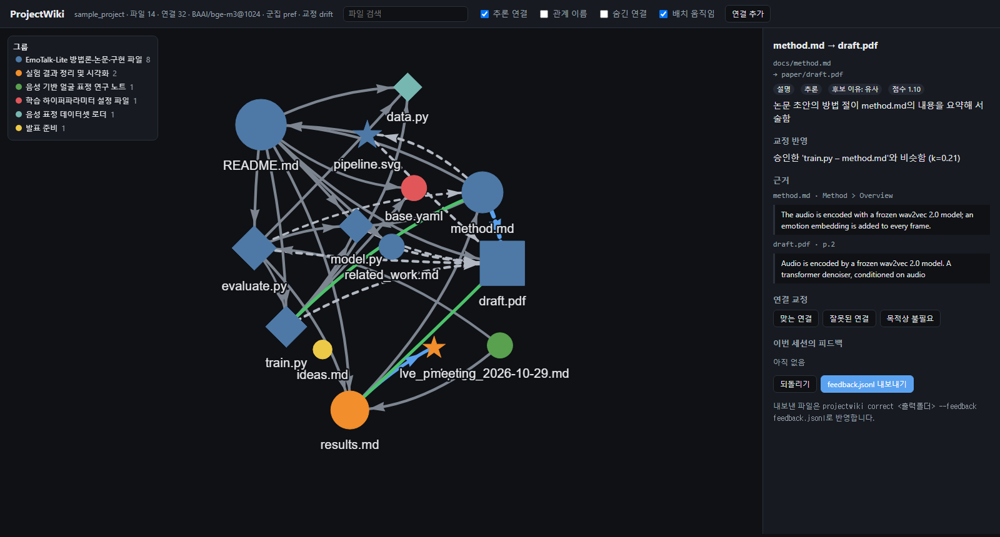
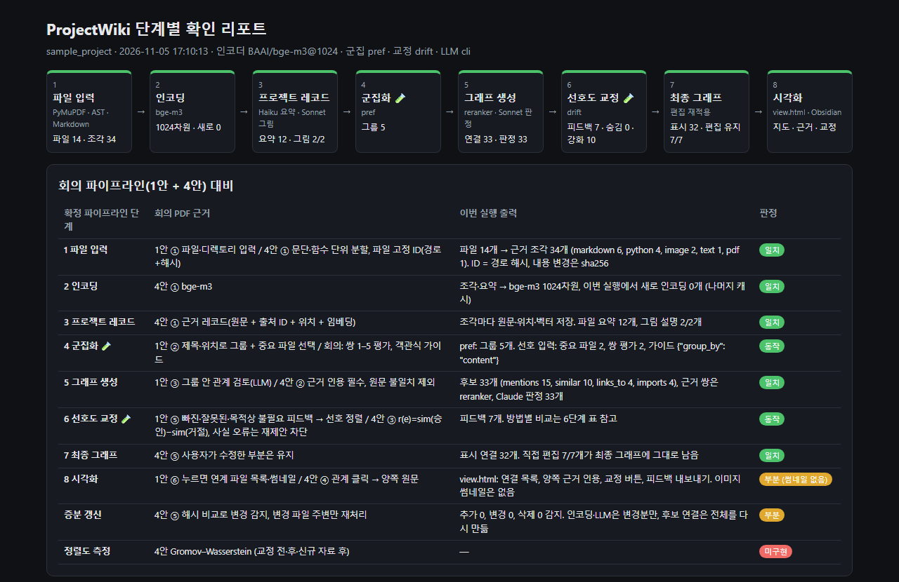

# ProjectWiki

로컬 프로젝트 폴더(논문·코드·노트·그림)를 위키처럼 정리하고 관리하는 도구입니다. KAIST AI618 Team 04 텀 프로젝트의 공통 베이스라인입니다.



- 파일마다 요약과 역할이 붙고, 파일끼리의 관계에는 양쪽 원문 근거가 달립니다.
- 사용자가 고친 내용(승인·거절·추가·그룹 이동)은 파일이 바뀌어 다시 생성해도 유지되고, 이후 제안에도 반영됩니다.
- 파이프라인은 11/05 팀 회의에서 정했습니다. 군집화와 선호도 반영은 **실험 구간(🧪)** 이라 각자 방법을 끼워 넣어 비교합니다.

## 파이프라인


파란 상자가 모델 단계(①–⑤)이고, 단계마다 [`projectwiki/models/`](projectwiki/models)의 파일 하나가 맡습니다.

| 모델 단계 | 파일 | 하는 일 | 모델·방법 |
|---|---|---|---|
| 1 인코딩 | [`encoder.py`](projectwiki/models/encoder.py) | 근거 조각과 파일 요약을 벡터로 (캐시) | **bge-m3** |
| 2 군집화 🧪 | [`clustering.py`](projectwiki/models/clustering.py) | 파일 → 그룹, 사용자 선호 반영 | `pref`: 중요 파일·쌍 1–5 평가·객관식 가이드 (회의안) / `baseline`: 선호 미반영 |
| 3 구조 생성 | [`structure.py`](projectwiki/models/structure.py) | 후보 연결 → 근거 쌍 선택 → 관계·방향·직접/추론 판정, 인용 검증 | **bge-reranker-v2-m3**, **Claude Sonnet 5.5** |
| 4 선호도 반영 🧪 | [`preference.py`](projectwiki/models/preference.py) | 사용자 피드백을 건드리지 않은 연결에 일반화 | `drift`: 커널 끌림/밀어냄 (회의 4안) / `align`: Bradley–Terry 선호 정렬 (회의 1안) / `baseline` |
| 5 시각화 | [`visualization.py`](projectwiki/models/visualization.py) | 뷰어(근거 보기·교정·피드백 내보내기), Obsidian 볼트 | vis-network |

흰 상자는 모델 단계 사이의 데이터 준비이고 [`projectwiki/srcs/`](projectwiki/srcs)가 맡습니다.

- **파일 입력**: `ingest.py`, `parsers.py`. PDF·Markdown·Python·Jupyter·텍스트·SVG를 근거 조각으로 나누고 import·링크를 뽑습니다.
- **프로젝트 레코드**: `enrich.py`, `record.py`. Claude가 그림 설명과 파일 요약·역할을 쓰고(Sonnet·Haiku 5.5), 변경을 감지합니다.
- **최종 그래프**: `finalize.py`. 교정 제안에 사용자의 직접 편집을 항상 우선해서 매번 다시 적용합니다.

폴더마다 파일별 역할을 적은 `README.md`가 있습니다. 구현 상세는 [docs/ARCHITECTURE.md](docs/ARCHITECTURE.md), 방법 추가 절차는 [CONTRIBUTING.md](CONTRIBUTING.md)에 있습니다.

## TODO

- [x] 공통 베이스라인 (인코딩·구조 생성·시각화, 파일 입력·레코드·최종 그래프)
- [x] 실험 구간 회의안: 군집화 `pref`, 교정 `drift`(4안)·`align`(1안), 대조군 `baseline`
- [x] Claude 연결: 구독 계정(Claude Code CLI)과 API 키 둘 다
- [x] 단계별 확인 리포트 (`projectwiki report`)
- [ ] 정렬도 측정: 사용자 관계도 ↔ AI 지도의 Gromov–Wasserstein 거리 (4안)
- [ ] 뷰어 이미지 썸네일 (1안 ⑥)
- [ ] 그룹·프로젝트 위키 페이지 생성
- [ ] 유저 스터디용 과제·로그 수집

## 설치

필요한 것:

- Python 3.11과 conda(Miniconda/Anaconda). conda가 없으면 스크립트가 `.venv`를 만듭니다.
- NVIDIA GPU 권장. CPU나 Apple MPS에서도 돌지만 느립니다.
- 디스크 약 10GB (PyTorch와 모델 4.5GB)
- Claude를 쓰는 방법 하나: **Claude 구독 계정으로 로그인한 Claude Code CLI**(기본) 또는 **API 키**. 둘 다 없으면 `--no-llm`으로 Claude 단계를 빼고 돌립니다. 아래 [Claude 연결 방식](#claude-연결-방식) 참고

### 한 번에 설치 (권장)

```bash
git clone git@github.com:mumbumble/AI618_ProjectWiki.git && cd AI618_ProjectWiki
bash scripts/setup.sh          # Linux / WSL / macOS   (GPU가 없으면 --cpu)
```

```powershell
# Windows PowerShell, conda를 쓸 수 있는 터미널에서
powershell -ExecutionPolicy Bypass -File scripts\setup.ps1     # GPU가 없으면 -Cpu
```

스크립트는 다음을 순서대로 합니다.

1. conda env `projectwiki`(Python 3.11)를 만듭니다.
2. 이 컴퓨터에 맞는 PyTorch 2.7.1을 설치합니다. NVIDIA GPU가 있으면 CUDA 12.6 버전입니다.
3. `requirements-dev.txt`를 설치합니다 (버전 고정).
4. 패키지를 설치합니다 (`pip install -e .`).
5. 모델 두 개를 받습니다.
6. 테스트와 `projectwiki doctor`를 실행합니다.

### 직접 설치

```bash
conda create -n projectwiki python=3.11 -y && conda activate projectwiki
pip install torch==2.7.1 --index-url https://download.pytorch.org/whl/cu126   # NVIDIA GPU
# pip install torch==2.7.1                                                    # macOS / CPU
pip install -r requirements-dev.txt
pip install -e . --no-deps
python scripts/download_models.py      # bge-m3, bge-reranker-v2-m3 (약 4.5GB)
```

### Claude 연결 방식

요약, 그림 설명, 그룹 이름, 관계 판정에 Claude를 씁니다. 둘 중 편한 쪽을 고르세요.

| | A. 구독 계정 (기본, `--llm-backend cli`) | B. API 키 (`--llm-backend api`) |
|---|---|---|
| 준비 | Claude Code CLI 설치 후 Pro/Max 계정으로 로그인 | Anthropic Console에서 API 키 발급 |
| 비용 | 구독 사용 한도에서 차감, 추가 청구 없음* | 토큰당 과금 (Sonnet 5.5 $2/$10, Haiku 5.5 $0.10/$0.50 per MTok) |
| 속도 | 호출당 약 5초, 동시 4개 | 더 빠름, 동시 8개 |
| 추천 | 테스트, 작은 폴더 | 큰 폴더, 반복 실험 |

\* claude.ai 설정에서 '추가 사용량(extra usage)'을 켜 두었다면 한도를 넘긴 만큼 과금될 수 있습니다. 로그에 찍히는 비용은 CLI가 알려주는 API 환산 금액이고 실제 청구액이 아닙니다.

**A. 구독 계정으로 쓰기**

```bash
curl -fsSL https://claude.ai/install.sh | bash      # Claude Code 설치 (또는 npm install -g @anthropic-ai/claude-code)
claude auth login                                   # 브라우저에서 claude.ai 계정으로 로그인
claude auth status                                  # "authMethod": "claude.ai" 이면 구독 사용
projectwiki build examples/sample_project -o runs/sample      # 기본이 cli라 옵션 없이 실행
```

WSL에서 쓴다면 WSL 안에서 Claude Code를 설치하고 로그인해야 합니다. 구독 한도를 아끼려면 `--llm-model claude-haiku-5-5`로 관계 판정과 그림 설명까지 Haiku로 돌리세요.

**B. API 키로 쓰기**

```bash
cp .env.example .env            # ANTHROPIC_API_KEY=sk-ant-... 입력 (.env는 git에 올라가지 않음)
projectwiki build examples/sample_project -o runs/sample --llm-backend api
```

기본값을 API로 바꾸고 싶으면 `--config`에 `{"llm_backend": "api"}`를 넣으세요.

**점검**: `projectwiki doctor`가 패키지, GPU, 모델 캐시, API 키, Claude Code CLI를 확인합니다.

```
[ok] torch 2.7.1+cu126 (transformers 5.x needs >= 2.6)
[ok] GPU: NVIDIA GeForce RTX 2070 SUPER (CUDA 12.6)
[ok] model cached: BAAI/bge-m3
[ok] model cached: BAAI/bge-reranker-v2-m3
[!!] ANTHROPIC_API_KEY not set
[ok] Claude Code CLI: /home/<user>/.local/bin/claude (--llm-backend cli)
ready with --llm-backend cli (or --no-llm)
```

## 실행

```bash
# 예제 폴더로 전체 파이프라인 실행 후 뷰어 열기
projectwiki build examples/sample_project -o runs/sample --prefs examples/prefs.example.json --open

# 뷰어에서 교정하고 'feedback.jsonl 내보내기' → 선호도 반영·최종 그래프·뷰어만 다시 실행 (파일을 다시 읽지 않음)
projectwiki correct runs/sample --feedback ~/Downloads/feedback.jsonl --open

# 본인 프로젝트 폴더 (출력은 기본으로 <폴더>/.projectwiki)
projectwiki build ~/my_project --purpose "다음 주 발표 준비"

# 대조군
projectwiki build ~/my_project -o runs/base --clusterer baseline --corrector baseline

projectwiki report runs/sample --open        # 단계별 확인 리포트 stages.html (교정 방법 비교 포함, 아래 그림)
projectwiki view runs/sample --open          # view.html만 다시 만들기
projectwiki obsidian runs/sample vault/      # Obsidian 볼트로 내보내기
```

| 옵션 | 뜻 |
|---|---|
| `--purpose "..."` | 사용자 목적. 관계 판정에 들어감 |
| `--prefs prefs.json` | 군집화 선호 입력 (중요 파일, 쌍 평가, 가이드). [예시](examples/prefs.example.json) |
| `--clusterer` / `--corrector` | 실험 구간 방법. 군집화 `pref`(기본)·`baseline`, 교정 `drift`(기본)·`align`·`baseline`. `패키지.모듈:클래스`도 가능 |
| `--llm-backend cli\|api` | Claude 연결 방식 (기본 `cli`) |
| `--llm-model` | 관계 판정·그림 설명 모델 (기본 `claude-sonnet-5-5`, 아끼려면 `claude-haiku-5-5`) |
| `--no-llm` | Claude 단계를 끔 (요약·그림 설명·그룹 이름·관계 판정) |
| `--no-rerank` | 근거 쌍을 코사인으로만 고름 |
| `--language English` | 요약·설명 언어 (기본 Korean) |
| `--config cfg.json` | [`config.py`](projectwiki/config.py)의 다른 설정값 바꾸기 |

`projectwiki report`가 만드는 `stages.html`은 회의에서 정한 흐름(파일 입력부터 시각화까지 8칸) 그대로, 칸마다 실제 출력과 판정을 보여줍니다.



### 뷰어 (`view.html`)

브라우저로 바로 엽니다. vis-network를 CDN에서 받으므로 인터넷이 필요합니다.

- **그래프 표시**
  - 노드 색: 그룹, 노드 모양: 파일 형식
  - 실선: 직접 근거, 점선: 추론
  - 파란 굵은 선: 승인, 초록 선: 사용자가 추가한 연결
- **노드 클릭**: 요약, 내용 미리보기, 연결 목록을 봅니다. 다른 그룹으로 옮기거나 그룹에서 뺄 수 있습니다.
- **연결 클릭**: 관계, 양쪽 원문 인용, 교정 반영 이유를 봅니다. **맞는 연결 / 잘못된 연결 / 목적상 불필요**로 표시합니다.
- **연결 추가**: 두 노드를 차례로 누르고 관계 이름을 적습니다 (예: "발표에 함께 쓸 자료").
- **피드백 내보내기**: `feedback.jsonl 내보내기`로 받은 파일을 `projectwiki correct`에 넘깁니다.

### 출력 폴더

```
runs/sample/
  record/              프로젝트 레코드: 파일·근거 조각·벡터 (파일 입력 + ① 인코딩)
  graph.json           ③ 구조 생성 결과 (교정 전)
  feedback.jsonl       누적 피드백 (실행할 때마다 다시 적용)
  correction.json      ④ 선호도 반영 결과     final_graph.json   최종 그래프
  view.html            뷰어              stages.html        단계별 확인 리포트 (report)
  run_info.json        변경 감지·단계별 시간  cache/        임베딩·Claude 응답 캐시
```

## 프로젝트 구조

```
AI618_ProjectWiki/
├── projectwiki/
│   ├── models/               모델 5단계 (단계마다 파일 하나)
│   │   ├── encoder.py            1 인코딩: bge-m3
│   │   ├── clustering.py         2 군집화 🧪: baseline · pref
│   │   ├── structure.py          3 구조 생성: reranker · Claude 판정
│   │   ├── preference.py         4 선호도 반영 🧪: baseline · drift · align
│   │   └── visualization.py      5 시각화: view.html · Obsidian
│   ├── srcs/                 모델 단계를 돕는 코드
│   │   ├── ingest.py · parsers.py      파일 → 근거 조각
│   │   ├── enrich.py · record.py       그림 설명·요약 → 프로젝트 레코드
│   │   ├── candidates.py · naming.py   후보 연결, 그룹 이름
│   │   ├── finalize.py · feedback.py   최종 그래프, 피드백 로그
│   │   ├── llm.py · claude_cli.py      Claude (API · 구독 CLI)
│   │   ├── report.py · doctor.py       단계별 리포트, 환경 점검
│   │   └── plugins.py · view_template.html
│   ├── pipeline.py           전체 순서
│   ├── cli.py                build / correct / view / report / obsidian / doctor
│   ├── config.py             모든 설정값
│   └── schema.py             단계 사이 데이터 형식
├── examples/                 예제 프로젝트 폴더, prefs·feedback 예시
├── scripts/                  setup.sh · setup.ps1 · download_models.py · make_sample_assets.py
├── tests/                    pytest (GPU·API 키 없이 실행)
├── docs/ARCHITECTURE.md      구현 상세
├── assets/                   README 그림
└── requirements.txt · requirements-dev.txt · pyproject.toml
```

## 테스트

```bash
pytest -q
```

TF-IDF 인코더와 가짜 Claude 클라이언트를 쓰므로 GPU와 API 키가 없어도 됩니다. push하면 GitHub Actions에서도 돕니다.

## 현재 상태 (2026-11-05)

| 확인 항목 | 결과 |
|---|---|
| 테스트 8개 (가짜 Claude·가짜 CLI 포함) | 통과 |
| 예제 폴더, `--llm-backend cli` (Sonnet 판정 + Haiku 요약) | 파일 14개 요약·그림 설명, 연결 33개 모두 관계·라벨·검증된 인용. 52회 호출, 3분 20초 |
| AI618 프로젝트 폴더 (파일 133개), `--llm-backend cli --llm-model claude-haiku-5-5` | 근거 조각 1008개, 이미지 45개 설명, 그룹 14개(선호 입력 반영), 후보 437개 판정(16개 탈락). 579회 호출, 21분 30초 |
| 같은 폴더에 예시 피드백 9개 | `drift` 숨김 35·강화 37, `align` 숨김 8·강화 5, 직접 편집 9/9 유지 |
| 증분 갱신 (폴더 복사본에서 파일 1개 수정, 1개 추가) | 변경 2건 감지, 새로 인코딩한 조각 2개, 직접 편집 9/9 유지 |
| 아직 없는 것 | 정렬도 측정(Gromov–Wasserstein), 뷰어 이미지 썸네일, 위키 페이지 생성 |

`projectwiki report <출력폴더>`로 같은 확인을 직접 할 수 있습니다. 구독(CLI) 방식은 호출마다 CLI 기본 프롬프트가 붙어서 사용량이 API보다 큽니다. AI618 폴더 실행의 API 환산 금액은 $19.6이었고, 구독 한도에서 차감됐습니다.

## 문제 해결

| 증상 | 해결 |
|---|---|
| `AutoModel requires PyTorch >= 2.6` | torch가 오래됨. 위 PyTorch 설치 명령을 다시 실행 |
| `ANTHROPIC_API_KEY is not set` | `--llm-backend api`일 때만 필요. `.env`에 키를 넣거나 기본값 `cli`를 쓰거나 `--no-llm` |
| `claude CLI not found` | Claude Code를 설치하고 `claude auth login`. WSL이면 WSL 안에 설치 |
| `claude CLI returned no structured output` 경고가 많음 | 로그인 만료(`claude auth status` 확인) 또는 구독 한도 도달. 한도가 풀린 뒤 같은 명령을 다시 실행하면 성공한 응답은 캐시에서 재사용 |
| 실행 시작이 느림 | 모델을 받은 뒤 `.env`에 `HF_HUB_OFFLINE=1` 추가 |
| `CUDA out of memory` | `--config`로 `batch_size`를 8이나 4로 낮춤 |
| 뷰어가 빈 화면 | 인터넷 연결(CDN) 확인, 브라우저 개발자 도구 콘솔 확인 |
| 그림 설명이 없음 | PyMuPDF가 못 읽는 형식이거나 4.5MB 초과. 로그 경고 확인 |

## 알려진 한계

- 교정 방법은 import·링크를 숨기지 못하고 점수만 바꿉니다. 이런 연결은 사용자만 지울 수 있습니다.
- `drift` 커널은 끝점 하나만 같아도 비슷하다고 봅니다. 예제에서 'meeting – base.yaml'을 거절하자 맞는 연결인 'base.yaml → train.py'도 숨겨졌습니다.
- `align`은 피드백 몇 개로 학습하므로 피드백이 한쪽에 몰리면 그쪽으로 일반화합니다. AI618 예시에서 승인이 모두 문서 쌍이었더니 코드 쪽 언급·유사 연결의 점수가 내려갔습니다.
- 파일명 언급은 문자열 일치로 찾습니다. 같은 이름의 파일이 여러 개면 상대 경로가 적혀 있어야 연결됩니다.
- 동영상·오디오는 경로만 씁니다.
- 관계 판정은 `max_judge_edges`(기본 2000)개까지입니다. 큰 폴더는 먼저 `--no-llm`으로 연결 수를 확인하세요.
