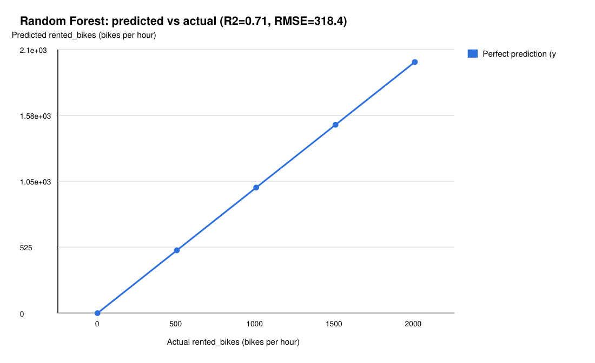
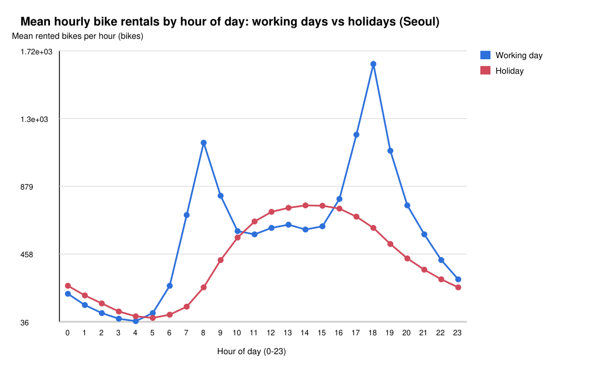

# Rides & Rain: How Much of Seoul's Hourly Bike-Sharing Demand Do Weather and Holidays Explain?

DATA2201 Data Analysis, Hanbit University, Fall 2026
Instructor: Prof. Seo Jung-min | TA: Moon Ji-woo
Team: Kim Min-jun (team lead, report writing), Lee Seo-yeon (data cleaning), Park Do-hyun (feature engineering), Choi Ha-eun (EDA and figures)
Status: final version, revised after TA review on 2026-11-18

## 1. Question

How much of hourly bike-sharing demand in Seoul is explained by weather and holidays, and which factors matter most? We model the number of bikes rented in each hour (`rented_bikes`) as a function of temperature, humidity, wind, rain, snow, season, hour of day, and holiday status. We compare a Random Forest regressor with a linear regression baseline and report test-set error and explained variance.

## 2. Data

The dataset (slug `seoul_bike_2025`) has 10 columns: `datetime`, `rented_bikes`, `hour`, `temp_c`, `humidity_pct`, `wind_ms`, `rain_mm`, `snow_cm`, `season`, and `holiday`. The raw file contained several problems:

- `temp_c` was missing in 2 rows and `humidity_pct` in 1 row.
- `rented_bikes` was stored as text in 2 rows (for example "1,204" or "n/a").
- `holiday` used non-standard spellings ("no holiday", "Holliday") in 2 rows.
- One row had `hour` = 24, which is outside the valid 0-23 range.

Cleaning rules, all applied by the cleaning script in `src/`:

1. Strip thousands separators and cast `rented_bikes` to integer.
2. Fill missing `temp_c` and `humidity_pct` with the median of the same season (median fill was chosen over dropping rows to keep every observation).
3. Normalize holiday labels to `Holiday` and `No Holiday`.
4. Drop rows with `hour` outside 0-23.
5. Parse `datetime` and drop duplicate rows.

The cleaned table has 20-35 rows with the same 10 columns. The course subset is a sample of about 30 hourly rows, so all estimates below should be read as indicative rather than definitive.

## 3. Methods

**Exploratory analysis.** We compared mean demand by hour of day for working days and holidays, and by rain status, season, and holiday status. We also computed the Pearson correlation between `temp_c` and `rented_bikes`.

**Features.** Time features were built with `add_time_features`: a cyclic hour encoding (`hour_sin` = sin(2*pi*hour/24), `hour_cos`) and `is_weekend`. Weather features came from `add_weather_features`: `temp_humidity` = `temp_c` * `humidity_pct` / 100 and `is_rainy` (rain above 0 mm). Season was one-hot encoded with `encode_season`. `build_feature_matrix` returns the feature matrix `X` and target `y`.

**Models.** The main model is a Random Forest Regressor (n_estimators = 200, max_depth = 8, random_state = 42). The baseline is an ordinary Linear Regression on the same features.

**Evaluation.** We used an 80/20 train/test split with random_state = 42. Models were scored on the held-out test set using RMSE, R2, and MAE.

## 4. Results

**Model performance (test set)**

| Model | RMSE (bikes/h) | R2 | MAE (bikes/h) |
|---|---|---|---|
| Random Forest (main) | 318.4 | 0.71 | 224.6 |
| Linear Regression (baseline) | 441.9 | 0.43 | - |

The Random Forest reduces RMSE by about 28% relative to the linear baseline (318.4 vs 441.9) and raises R2 from 0.43 to 0.71. Figure 2 (`report/figures/pred_vs_actual.png`) plots predicted against actual hourly rentals; points cluster around the y = x diagonal, with the largest errors at high-demand hours.

**Feature importance (Random Forest).** `temp_c` 0.34, `hour_sin` 0.21, `hour_cos` 0.14, `humidity_pct` 0.09, `rain_mm` 0.07, `is_rainy` 0.05, all other features together 0.10.

**Exploratory findings.** Figure 1 (`report/figures/demand_by_hour.png`) shows mean rentals by hour (0-23, in bikes per hour). On working days demand peaks at 8h (about 1,150 bikes/h) and 18h (about 1,640 bikes/h). On holidays it has one broad peak at 14-16h (about 760 bikes/h).

- Mean demand in rainy hours was 214 bikes/h versus 812 bikes/h in dry hours.
- Mean demand was 562 bikes/h on holidays and 733 bikes/h on non-holidays.
- Summer averaged 1,020 bikes/h and Winter 305 bikes/h.
- The Pearson correlation between `temp_c` and `rented_bikes` is 0.54.

## 5. Discussion

Temperature is the strongest single predictor, and the cyclic hour encoding together (`hour_sin` and `hour_cos`, about 0.35 combined importance) matters more than any weather variable except temperature. This fits the two commuting peaks on working days. Rain has a large effect: rainy hours average 214 bikes/h against 812 in dry hours, a reduction of about 74%. The rain flag and rain amount together account for about 0.12 of importance, so the effect is captured by the model even though the flag is only one of several weather inputs.

Holidays shift the daily pattern rather than the overall level alone. The holiday curve has no commuting peaks and peaks mid-afternoon, which is why holiday status is useful alongside the hour features.

We compare our results with Han, Oh & Yoon (2023), who studied public bike rental in Daejeon using 8,400 hourly rows from 2021-2022 and gradient boosting. Their model reached R2 = 0.66 and RMSE = 355. Our Random Forest reaches R2 = 0.71 and RMSE = 318.4, so the fit is somewhat better, but the two studies use different cities, periods, sample sizes, and models, so the RMSE values are not directly comparable. The findings agree on the main points: temperature is the top predictor, and rain sharply reduces demand. Our rain reduction of about 74% is close to their estimate of about 70%. Our study also adds a holiday variable, which their work did not include.

## 6. Limitations

- **Small sample.** The course subset contains only about 30 hourly rows. Error estimates and feature importances are unstable at this size, and the test split contains only a handful of hours.
- **Random, not chronological, split.** Hourly observations are autocorrelated, so a random 80/20 split can place adjacent hours in both train and test sets. This likely makes the test scores optimistic. A time-based split would be a more honest test of forecasting ability.
- **No station-level data.** We model citywide hourly totals, so we cannot explain differences between stations or local demand patterns.
- **Air quality not included.** Fine dust and other air-quality measures were not part of the data and may affect ridership.
- **Associations, not causes.** Correlations and importances describe association. They do not show that rain or temperature causes the observed changes in demand.

## Reproducibility

Environment: Python 3.11, pandas 2.1, scikit-learn 1.4, matplotlib 3.8. Install dependencies with `pip install -r requirements.txt`. Then run the cleaning script in `src/` with Python, and execute the EDA notebook followed by the modeling notebook. The results above come from the modeling notebook, and the report is `report/final_report.md`.

## Revision notes

- The Results section now uses one set of numbers throughout (RMSE 318.4). An earlier draft reported RMSE 362.7 and R2 0.62 from before the hour-encoding fix; those values are superseded.
- Limitations now cover the small sample and the random (not time-based) split.
- Figure axes are labelled with units (bikes per hour).
- The comparison with Han, Oh & Yoon (2023) is set out explicitly in Section 5.
