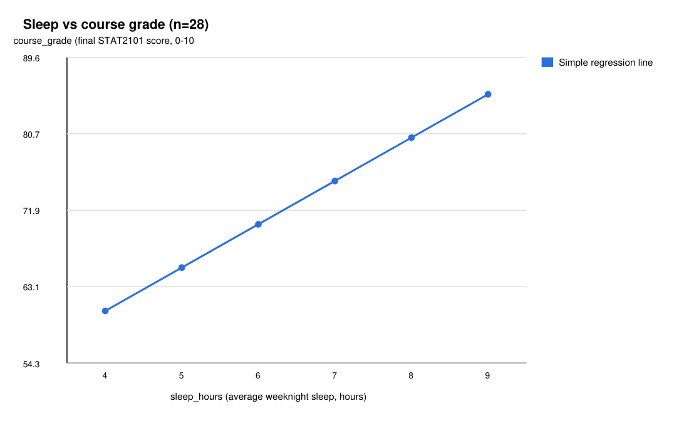
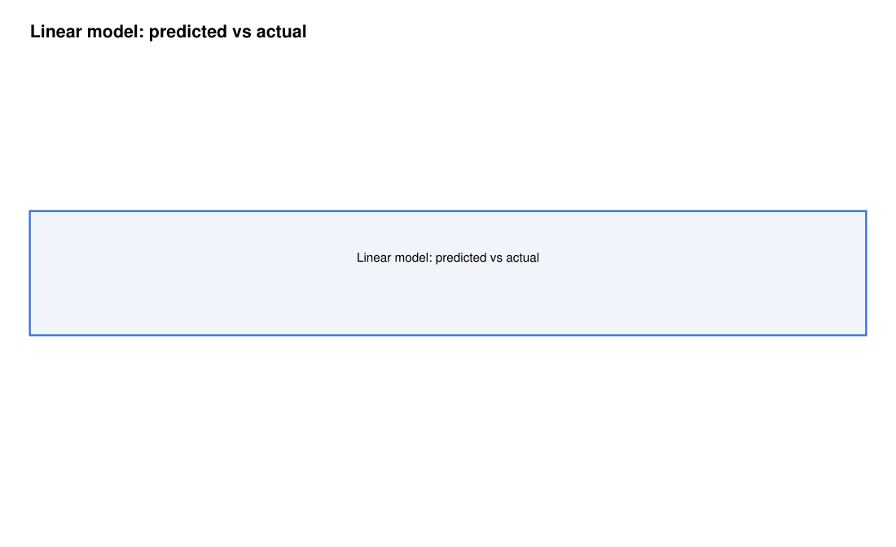

# Sleep, Part-time Work and Course Grades: A Student Survey

STAT2101 Introduction to Data Analysis, Fall 2026, Hanbit University
Instructor: Prof. Yoon Seong-min | Team: Kim Min-jun (team lead, data cleaning), Lee Seo-yeon (feature engineering), Park Ji-ho (EDA and figures), Choi Yuna (report)

## 1. Question

Do weeknight sleep duration and weekly part-time work hours predict the final STAT2101 grade? As a secondary question, we check whether self-study time adds predictive value once sleep and work are known.

## 2. Data

We used an online survey of STAT2101 students open from 2026-09-21 to 2026-10-02. The raw export has 32 rows and seven variables: student_id (S001 to S032), gender, year (academic year, 1 to 4), sleep_hours (average weeknight sleep, valid 3 to 12), work_hours (part-time hours per week, valid 0 to 40), study_hours (self-study hours per week, valid 0 to 30), caffeine_cups (cups per day, 0 to 8), and course_grade (final STAT2101 score, 0 to 100).

Cleaning removed 4 rows, which leaves 28 clean rows:

- 1 duplicate row (S014 appeared twice; one copy was kept).
- 3 invalid rows: S022 had no course_grade, S027 reported sleep_hours of 25 (outside the valid range), and S030 had the text "abc" as course_grade.

Two free-text sleep entries were converted to numbers: S003 "7h" became 7.0 and S017 "six and half" became 6.5. Two values were imputed with the column median: S005 work_hours (10.0) and S011 study_hours (8.0). The cleaned file has the same eight columns, correct data types, and no missing values.

Numbers from an earlier draft (r = 0.52 and training RMSE 5.88) were computed before these fixes, when the duplicate was kept and S027 was not removed. They are superseded by the values in this report.

**Table 1. Descriptive statistics (clean data, n = 28)**

| Variable | Mean | SD |
|---|---|---|
| sleep_hours | 6.8 | 0.9 |
| work_hours | 11.4 | 8.3 |
| study_hours | 8.6 | 3.9 |
| course_grade | 74.3 | 9.8 |

## 3. Methods

**Cleaning.** The cleaning script uses three functions: parse_hours() converts text durations, drop_invalid() removes duplicate and out-of-range rows, and impute_median() fills the two missing numeric values.

**Features.** The model uses three predictors, sleep_hours, work_hours and study_hours, assembled by build_feature_matrix(). Two derived flags were also tested: sleep_deficit (max(0, 7.0 − sleep_hours)) and work_heavy (1 if work_hours ≥ 15). Neither was kept (see Section 4.3).

**Correlations (A2).** We computed Pearson correlations between each predictor and course_grade, and between sleep_hours and work_hours.

**Model (A3).** We fitted an ordinary least squares linear regression (scikit-learn LinearRegression) with the three predictors. Linear models were chosen over tree models because the sample is small. Performance was estimated with leave-one-out cross-validation (LOO-CV) across all 28 students. The reported RMSE and R2 are computed on the held-out predictions, not on the training data. A baseline that always predicts the mean grade gives the reference RMSE.

**Figures (A4).** Figure 1 is the EDA scatter plot of sleep against grade. Figure 2 plots LOO-CV predictions against actual grades.

**Prior study (A5).** We compare our findings with Han and Oh (2024) in Section 5.

**Reproducibility.** Random seed is 2026. To reproduce, install pandas, numpy, scikit-learn, matplotlib and jupyter under Python 3.11, run the cleaning script in src/ on the raw survey file, then run the EDA notebook and the modeling notebook in order. The report is in report/final_report.md.

## 4. Results

### 4.1 Correlations with course grade

**Table 2. Pearson correlations (n = 28)**

| Pair | r |
|---|---|
| sleep_hours with course_grade | 0.46 |
| study_hours with course_grade | 0.44 |
| work_hours with course_grade | −0.38 |
| sleep_hours with work_hours | −0.19 |

Sleep and work are only weakly correlated, so each carries its own information. A simple regression of grade on sleep gives a slope of 5.0 grade points per extra hour of sleep.

Nine of the 28 students work 15 or more hours per week. Their mean grade is 69.1, compared with 76.9 for the other 19. Eleven students sleep less than 7 hours a night.

*Figure 1. Blue points: under 15 work hours per week. Orange points: 15 or more. The black line is the regression of grade on sleep (slope 5.0).*

### 4.2 Linear model with cross-validation

**Table 3. Model performance (metrics from leave-one-out CV, n = 28)**

| Model | LOO-CV RMSE | LOO-CV R2 |
|---|---|---|
| Baseline (predict the mean grade) | 9.97 | — |
| Linear model: sleep, work, study | 6.42 | 0.41 |

The model reduces RMSE from 9.97 to 6.42 grade points compared with the mean baseline, and explains about 41% of the variance in held-out grades.

**Table 4. Coefficients of the final model (fitted on all 28 rows, for interpretation only)**

| Term | Coefficient |
|---|---|
| Intercept | 41.2 |
| sleep_hours | +3.1 per hour |
| work_hours | −0.48 per hour |
| study_hours | +1.05 per hour |

*Figure 2. Points close to the dashed 45-degree line are predicted well. The annotation gives the LOO-CV RMSE and R2.*

### 4.3 Feature ablation

**Table 5. Feature sets compared with LOO-CV**

| Feature set | LOO-CV RMSE | LOO-CV R2 |
|---|---|---|
| sleep_hours only | 8.74 | 0.21 |
| sleep_hours + work_hours | 7.71 | 0.32 |
| sleep_hours + work_hours + study_hours (kept) | 6.42 | 0.41 |
| above + sleep_deficit + work_heavy | 6.71 | 0.37 |

Adding each predictor lowers the error. The two derived flags made the model worse, so they were dropped.

## 5. Discussion

The answer to the research question is yes, but the predictive power is moderate. Holding work and study hours fixed, each extra hour of weeknight sleep goes with about 3.1 more grade points. Each extra hour of weekly work goes with about 0.48 fewer points, so 10 more work hours goes with about 4.8 fewer. Study time also adds predictive value. The large group gap (69.1 vs 76.9) suggests that heavy work matters in practice, although the group comparison does not adjust for sleep or study time.

Our results are consistent with Han and Oh (2024), who surveyed 412 students at three universities. They reported a sleep–grade correlation of r = 0.31, and found that working more than 15 hours per week lowered the GPA-scaled grade by 3.2 points. Their linear model reached R2 = 0.18. Our sleep–grade correlation (r = 0.46) is larger than theirs. With only 28 students, however, the 95% confidence interval for our r is roughly 0.10 to 0.71, so the difference between the two studies is not reliable. The direction of both effects agrees: more sleep and less work go with higher grades. Our R2 of 0.41 is not directly comparable with their 0.18, because ours is an out-of-sample LOO-CV estimate on a 0 to 100 score, while their grade is GPA-scaled. Their sample is also much larger.

## 6. Limitations

- **Small sample.** Only 28 students from one course were analysed. Correlations and coefficients are imprecise, and the LOO-CV estimates depend on a few students.
- **Self-reported data.** Sleep and work hours come from an online survey and may contain recall error. Students may round their sleep hours.
- **Cleaning choices.** Four rows were dropped, and two values (S005 work_hours and S011 study_hours) were imputed with the median. If the dropped students differ from the rest, the results may be biased.
- **Cross-sectional design.** The data cannot show causation. Students with weaker grades may also take on more work, so the effect could run in either direction.
- **Model scope.** We did not test interaction terms (for example sleep × work) or non-linear effects. The thresholds of 7 hours and 15 hours were fixed in advance and not tuned, but other cutoffs could change the derived-flag results.
- **Single term.** The results describe one course in one semester and may not generalise to other courses.
