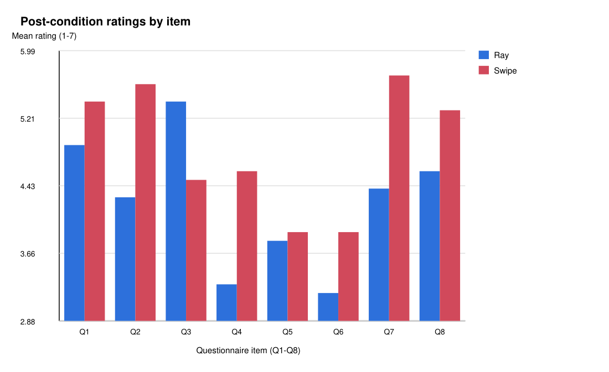

# VRType Study: Findings

This document summarizes the main results of the VRType study, which compared two VR text-entry methods: a ray-casting keyboard (`ray`) and a hand-tracking swipe keyboard (`swipe`). The study was run by the HCI Lab (HCIL) at Hanbit University. Results come from the main study (app v0.3.3, 2026-09-14 to 2026-10-02) with N = 16 participants (P01-P16).

## 1. Study overview

We used a within-subjects design with two conditions and four tasks per condition. Each participant completed both conditions, with the order counterbalanced by a Latin square (8 participants started with `ray`, 8 with `swipe`). Tasks always ran in the same order inside a condition: T1 (copy a common five-word phrase), T2 (copy a two-sentence message of about 60 characters), T3 (enter an 8-character password-like string with one digit and one symbol), and T4 (enter a URL). Each condition began with a 3-minute practice period.

The sample had 16 adults aged 20-34 (mean age 25.6), 7 women and 9 men, all right-handed. Eleven had used VR before. Participants were compensated with 15,000 KRW. Nobody was excluded. P09 had a brief tracking loss during swipe T2; that trial was kept.

The dependent measures were seconds per task, errors per task (backspace-corrected errors plus uncorrected wrong characters or words), derived speed in words per minute (WPM), and a 7-point Likert questionnaire (Q1-Q8) completed after each condition. A semi-structured interview of about 10 minutes was held at the end of each session.

## 2. Task completion time

Swipe was faster than ray. Averaged across participants, the mean time per task was 41.8 s (SD 9.6) for `ray` and 33.2 s (SD 8.1) for `swipe`, a 20.6% reduction. The per-task means were:

| Task | Ray (s) | Swipe (s) |
|------|---------|-----------|
| T1 (phrase) | 22.4 | 16.9 |
| T2 (message) | 58.3 | 45.1 |
| T3 (password-like string) | 47.6 | 38.0 |
| T4 (URL) | 38.9 | 32.8 |

We compared conditions with a two-sided Wilcoxon signed-rank test on per-participant means (n = 16, alpha = .05). The result was W = 7, p = .002, r = 0.79. Swipe was significantly faster than ray. Swipe was faster on every task, so the advantage was not limited to one task type.

## 3. Errors

Swipe produced more errors than ray. The mean number of errors per task was 1.9 (SD 1.1) for `ray` and 3.4 (SD 1.6) for `swipe`, which is 79% more errors for swipe. Per-task means were:

| Task | Ray | Swipe |
|------|-----|-------|
| T1 (phrase) | 1.0 | 2.1 |
| T2 (message) | 2.6 | 4.2 |
| T3 (password-like string) | 2.3 | 4.1 |
| T4 (URL) | 1.7 | 3.2 |

The same Wilcoxon signed-rank test (two-sided, per-participant means, n = 16, alpha = .05) gave W = 10, p = .004, r = 0.74. The difference in errors is statistically significant. In the swipe condition, many errors came from the decoder choosing a neighboring word, and some were caught by backspace. The high rate of errors in T3 reflects the symbol and digit requirement in that task.

Derived speed in WPM, computed from T1 and T2, was 15.1 for ray and 19.0 for swipe. These values are descriptive. They are not part of the significance tests above.

## 4. Hypothesis outcomes and speed-accuracy trade-off

Both pre-registered hypotheses from the proposal are supported.

- **H1 (swipe is faster than ray):** Supported. Seconds per task were lower for swipe (W = 7, p = .002).
- **H2 (swipe produces more errors than ray):** Supported. Errors per task were higher for swipe (W = 10, p = .004).

Together, these results show a speed-accuracy trade-off. Swipe allowed participants to finish tasks faster but at the cost of more errors. Ray was slower but produced cleaner text. Participants also rated ray as more accurate (Q3), which matches the error data. The trade-off should be a central point in any write-up, because a practical choice between the two methods depends on whether the application can tolerate extra correction effort.

Arm fatigue is another important part of this trade-off. Participants reported more arm fatigue with swipe (Q4: 4.6 vs. 3.3 on the 7-point scale, p = .011). This is consistent with the prior finding by Han & Oyelaran (2023) that arm fatigue grows during mid-air typing, and it suggests that the faster method also carries a physical cost.

## 5. Post-condition ratings

*Figure: Mean post-condition ratings for Q1-Q8 (1 = strongly disagree, 7 = strongly agree). Error bars show 95% confidence intervals.*

| Item | Ray | Swipe | p (Wilcoxon) |
|------|-----|-------|--------------|
| Q1 Ease of use | 4.9 | 5.4 | .09 |
| Q2 Perceived speed | 4.3 | 5.6 | .003 |
| Q3 Perceived accuracy | 5.4 | 4.5 | .021 |
| Q4 Arm fatigue (higher = more fatigue) | 3.3 | 4.6 | .011 |
| Q5 Mental demand | 3.8 | 3.9 | n.s. |
| Q6 Frustration | 3.2 | 3.9 | n.s. |
| Q7 Enjoyment | 4.4 | 5.7 | .004 |
| Q8 Willingness to use again | 4.6 | 5.3 | .12 |

Participants felt that swipe was faster (Q2) and more enjoyable (Q7), and they rated ray as more accurate (Q3) and less tiring (Q4). Differences in ease of use (Q1), mental demand (Q5), frustration (Q6), and willingness to use again (Q8) were not significant. The survey tests are uncorrected for multiple comparisons, so the Q3 and Q4 results, which are near the .05 threshold after accounting for the number of items, should be interpreted with some caution.

## 6. Limitations and notes

- **Pilot data are excluded.** The pilot (4 participants, app v0.3.2, 2026-08-25 to 2026-08-28) is not part of these results. It revealed a swipe bug in which the stroke buffer was not cleared after Backspace, causing the last word to be duplicated. The bug was fixed in v0.3.3 by calling `clear_stroke_buffer()` on backspace, and the main study used the fixed version.
- **T3 was changed after the pilot.** The original 12-character random strings led 3 of 4 pilot participants to give up or take over 2 minutes. The main study used the shorter 8-character string with one digit and one symbol.
- **Sample.** The sample is small (N = 16) and drawn from young adults. Results may not transfer to other age groups or to longer sessions. Sessions were capped at 60 minutes.
- **Hardware.** All sessions used the Aurora V2 headset with built-in hand tracking and controllers. Results may differ on other devices.
- **Decoder.** The swipe decoder used a 20,000-word lexicon and a bigram language model with a beam width of 8, showing the top three candidates. Error rates depend on these settings.

## 7. Next steps

At the advisor meeting on 2026-11-10, Professor 김태호 reviewed these findings and agreed that H1 and H2 are supported. The advisor asked us to:

1. Report the speed-accuracy trade-off and arm fatigue (Q4) more prominently in the write-up.
2. Confirm the planned analysis (two-sided Wilcoxon signed-rank tests) against the study proposal, which this summary follows.
3. Add the per-task breakdown for time and errors, as shown in Sections 2 and 3.

The team plans to submit the manuscript to a conference in January 2027. Interview responses (perceived speed, accuracy and errors, arm fatigue, enjoyment, mental effort and frustration, willingness to reuse, and preferred method) are collected separately and are not summarized in this document.

Prepared by 박서연 (lead researcher), with prototype support from 이도윤 and data analysis by 정하은. Pilot facilitation was done by 최민준.
