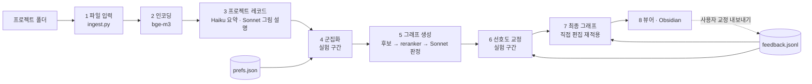

# 구현 상세

단계별 입력·처리·출력과 코드 위치를 정리했습니다. 숫자로 된 설정값은 모두 [`projectwiki/config.py`](../projectwiki/config.py)의 기본값이며 `--config cfg.json`으로 바꿀 수 있습니다.



## 데이터 형식 (`schema.py`)

| 형식 | 주요 필드 | 만드는 곳 |
|---|---|---|
| `Chunk` | `id` (`<file id>#<n>`), `kind`, `locator` (`p.3`, `Method > Loss`, `def train (L10-L42)`), `text` | 1 |
| `FileRecord` | `id` (상대 경로의 sha1 앞 10자리, 내용이 바뀌어도 유지), `path`, `type`, `sha256`, `chunk_ids`, `refs`, `summary`, `role` | 1, 3 |
| `Group` | `id`, `name`, `description`, `members`, `origin` (`ai`/`user`) | 4 |
| `Edge` | `id` (파일 쌍마다 하나), `source`→`target`, `relation`, `reason`, `direct`, `score`, `label`, `evidence[]`, `origin`, `status`, `correction` | 5–7 |
| `Preferences` | `purpose`, `anchors`, `guide`, `pairs` | 사용자 |
| `FeedbackEvent` | `type`, `source`, `target`, `node`, `group`, `relation`, `note`, `ts` | 사용자 (뷰어) |

`Edge.status`:

| 값 | 뜻 | 뷰어 |
|---|---|---|
| `proposed` | AI 제안 | 표시 |
| `confirmed` | 사용자가 승인하거나 추가 | 표시 (파란/초록 굵은 선) |
| `removed_wrong` / `removed_irrelevant` | 사용자가 거절 | "숨긴 연결"을 켜면 빨간 점선 |
| `removed_by_corrector` | 6단계 교정 방법이 숨김 | 위와 같음 |
| `llm_rejected` | Sonnet 판정이 의미 없다고 봄 (import·링크는 제외) | 위와 같음 |
| `removed_low_score` | `min_score` 미만 추론 연결 | 위와 같음 |

## 1. 파일 입력 — `ingest.py`

- 숨김 파일·폴더, `node_modules`, `__pycache__`, `venv`, `*:Zone.Identifier`, 그리고 `Config.ignore` glob에 맞는 경로는 건너뜁니다.
- 형식별 근거 조각 분할 (조각 하나 최대 `max_chars`=1500자):
  - PDF: PyMuPDF로 쪽마다 텍스트를 뽑습니다 (최대 300쪽).
  - Markdown: 제목 경로 단위로 나누고 코드 블록 안의 `#`은 무시합니다. `[..](path)` 링크와 `[[위키링크]]`를 참조로 기록합니다.
  - Python: AST로 모듈 수준 코드 1조각과 최상위 함수·클래스마다 1조각을 만듭니다 (줄 범위 포함). 절대·상대 import를 참조로 기록합니다.
  - Jupyter: 셀마다 나눕니다. Markdown 셀의 링크와 코드 셀의 import를 기록합니다.
  - 텍스트·코드·설정: 그대로 나눕니다. CSV·TSV·log는 앞 40줄만 씁니다. SVG는 안의 텍스트를 씁니다.
  - 이미지·동영상·바이너리·50MB 초과·읽기 실패: 경로 단어만 담은 `path` 조각 하나를 만듭니다.
- 텍스트 인코딩은 UTF-8, CP949, latin-1 순서로 시도합니다.

## 2–3. 인코딩과 프로젝트 레코드 — `models.py`, `record.py`

- **그림 설명**: 이미지를 PyMuPDF로 1568px 이하 PNG로 줄입니다. Claude Sonnet 5.5가 설명 2–4문장과 역할을 만들고, 이 설명이 `path` 조각을 대체합니다 (최대 `max_images`=200개).
- **파일 요약**: 앞쪽 약 8000자를 보고 Claude Haiku 5.5가 요약 2–3문장과 역할(예: "학습 스크립트")을 씁니다.
- **인코딩**:
  - 입력: `"{경로} | {위치}\n{본문}"` 형태의 조각과 요약문
  - 모델: bge-m3 dense (정규화한 [CLS], 최대 1024토큰, CUDA에서는 fp16)
  - 캐시: 텍스트 해시 기준으로 `cache/emb_*.npz`에 저장하므로 다시 실행하면 바뀐 조각만 인코딩합니다.
- **파일 벡터**: `normalize(normalize(조각 벡터 평균) + 요약 벡터)`.
- **변경 확인**: 이전 실행과 비교해 추가·변경·삭제된 파일을 로그에 남깁니다.
- **저장**: `record/`에 둡니다.

## 4. 군집화 (실험 구간) — `cluster/`, `groups.py`

인터페이스는 `Method(cfg).cluster(record, prefs) -> list[Group]`입니다. 일부 파일을 그룹에 넣지 않아도 됩니다.

- **`baseline`** (대조군): 거리 = α·(1−cos) + (1−α)·폴더 트리 거리 (α=0.6)로 평균 연결 계층 군집을 합니다. 자르는 기준은 전체 거리의 35백분위입니다.
- **`pref`** (회의안):
  - `guide.group_by`: `folder`면 α=0.2, `content`면 α=0.9, 그 외는 기본값입니다.
  - `pairs`: 평가한 쌍의 거리를 `(5−점수)/4`로 고정합니다.
  - `anchors`: 중요 파일마다 그룹이 하나씩 생깁니다. 가장 가까운 중요 파일과의 거리가 25백분위 이하인 파일은 그 그룹에 붙고, 나머지는 baseline 방식으로 묶습니다.
- **그룹 이름** (공통): Claude Haiku 5.5가 구성원의 경로·역할·요약을 보고 다섯 단어 이하의 이름과 한 문장 설명을 붙입니다. LLM을 끄면 공통 폴더 이름을 씁니다.

## 5. 그래프 생성 — `graph.py`

1. **후보 연결** (파일 쌍마다 하나, 우선순위는 import·링크 > 언급 > 유사):
   - `imports`: 프로젝트 안 모듈로 해석되는 import입니다. 상대 import와 `src/` 레이아웃도 해석합니다.
   - `links_to`: Markdown 링크와 위키링크입니다.
   - `mentions`: 다른 조각에 상대 경로나 고유한 파일명이 적혀 있는 경우입니다. 5자 이상이어야 하고 `README.md` 같은 흔한 이름은 제외합니다.
   - `similar`: 그룹 안에서 파일마다 bge-m3 유사도 상위 3개를 고릅니다. 기준은 전체 쌍 유사도의 75백분위 이상이고, 그룹 밖은 97백분위 이상인 1개만 고릅니다.
2. **근거 쌍**: 코사인 상위 8개 조각 쌍을 bge-reranker-v2-m3로 다시 점수 매겨 가장 높은 쌍을 근거로 씁니다. `similar` 연결의 점수는 이 리랭커 확률입니다.
3. **관계 판정**: Claude Sonnet 5.5(effort low)가 JSON 스키마로 답합니다.
   - 입력: 사용자 목적, 후보 이유, 양쪽 파일의 요약과 근거 조각
   - 출력: `keep`, `relation`(12종), `direction`, `label`, `direct`, `quote_a`, `quote_b`
   - 인용 검증: 인용이 근거 조각에 그대로(공백만 정규화) 없으면 버립니다.
   - 직접/추론 구분: `direct`는 후보 이유가 명시적 참조이거나, 판정이 직접이라고 했고 검증된 인용이 있을 때만 참입니다.
   - 탈락: `keep=false`면 `llm_rejected`가 되지만, import와 링크는 제외합니다.
   - 판정 대상은 최대 `max_judge_edges`=2000개입니다.

## 6. 선호도 교정 (실험 구간) — `correct/`

인터페이스는 `Method(cfg).correct(graph, feedback, record) -> Correction`입니다. `Correction`의 필드는 다음과 같습니다.

- `edge_scores`
- `hide`
- `new_edges`
- `node_groups`
- `explanations` (뷰어에 "교정 반영" 이유로 표시)

사용자가 직접 건드린 연결은 7단계가 처리하므로 여기서 다루지 않아도 됩니다.

- **`baseline`** (대조군): 아무것도 바꾸지 않습니다.
- **`drift`** (회의 4안, 학습 없음):
  - 커널 중심
    - 승인(`edge_confirm`, `edge_add`)한 연결은 끌어당깁니다.
    - '목적상 불필요'(`edge_irrelevant`)로 거절한 연결은 밀어냅니다.
    - '사실 오류'(`edge_wrong`)는 차단만 하고 중심으로 쓰지 않습니다.
  - 쌍 유사도 s: 두 연결의 끝점을 맞춰 bge-m3 코사인을 평균하고, 두 방향 중 큰 값을 씁니다.
  - 커널: k = exp(−(1−s)/τ)이고, 관계 종류가 다르면 ×0.7을 합니다 (τ=0.1).
  - 점수: score += gain·(승인 연결과의 k 평균 − 거절 연결과의 k 평균).
  - 숨김: 가장 비슷한 판정 연결이 거절된 것이고 k ≥ margin(0.2)이면 숨깁니다. 승인된 것이면 강화하고 이유를 남깁니다.
- **`align`** (회의 1안, 피드백으로 선호 정렬):
  - 학습 데이터: 승인한 연결(`edge_confirm`, `edge_add`)과 거절한 연결(`edge_wrong`, `edge_irrelevant`)의 모든 쌍
  - 모델: Bradley–Terry s(e) = w·φ(e), 손실 −log σ(s(승인) − s(거절)) + L2 (`align_l2`=1.0). 학습하는 것은 w뿐입니다.
  - 특징 φ(e): 두 파일 벡터의 원소곱(PCA 16차원), 두 파일의 코사인 유사도, 폴더 거리, 같은 그룹 여부. 사용자가 추가한 연결도 AI 연결과 같은 방식으로 표현되도록 파일 내용과 위치만 씁니다.
  - 적용: 사용자가 건드리지 않은 연결을 다시 점수 매깁니다. 거절한 어떤 연결보다 점수가 낮으면 숨기고, 승인 평균보다 높으면 강화합니다. 새 점수는 거절 평균이 약 0.12, 승인 평균이 약 0.88이 되도록 맞춘 확률입니다.

## 7. 최종 그래프 — `finalize.py`

1. 교정 방법의 제안(점수, 숨김, 새 연결, 그룹, 이유)을 적용합니다. 단, import와 링크는 파일에 적힌 사실이라 교정 방법이 숨길 수 없고 점수만 바뀝니다. 이런 연결은 사용자만 지울 수 있습니다.
2. `feedback.jsonl`의 직접 편집을 순서대로 다시 적용합니다. 나중 이벤트가 앞 이벤트를 덮습니다.
   - `edge_add`: 사용자 연결이 생기고 `confirmed`가 됩니다.
   - `node_move`: 기존 그룹 id나 새 그룹 이름(`u1`, `u2`…)으로 옮깁니다.
3. `min_score` 미만인 추론 연결은 `removed_low_score`가 됩니다. 마지막으로 그룹 구성원을 다시 계산하고 빈 그룹을 지웁니다.

피드백 로그는 실행할 때마다 처음부터 다시 적용됩니다. 그래서 파일이 바뀌어 다시 생성해도 사용자 편집이 유지됩니다. 삭제된 파일을 가리키는 이벤트는 경고만 남기고 건너뜁니다.

## 8. 시각화 — `viz/`

- `view.html`: 데이터를 HTML 안에 넣은 단일 파일입니다. vis-network는 unpkg CDN에서 받으므로 인터넷이 필요합니다. 세션 중 피드백은 브라우저 localStorage에 임시 저장되고, "내보내기"로 `feedback.jsonl`을 받습니다.
- `projectwiki obsidian <out> <vault>`: 파일마다 노트 하나를 만들고, 연결은 `[[위키링크]]`와 근거 인용으로, 그룹은 `group/<이름>` 태그와 `_groups/` 노트로 내보냅니다.

## 단계별 확인 리포트 — `report.py`

`projectwiki report <out>`은 `stages.html`을 만듭니다. 한 페이지에 다음이 들어갑니다.

- 8단계 띠와 회의 파이프라인(1안 + 4안) 대비 판정표
- 단계마다 실제 출력: 형식·폴더 분포, PCA 산점도, 레코드 예시, 그룹표, 후보 이유와 근거 예시, 최종 그래프 그림
- 6단계 비교: 등록된 교정 방법(`baseline`, `drift`, `align`, 새로 추가한 방법)을 같은 그래프와 피드백으로 다시 계산해 나란히 보여줌
- 직접 편집이 최종 그래프에 남았는지 확인하는 표, 증분 갱신 결과, 단계별 시간

차트는 외부 라이브러리 없이 인라인 SVG로 그립니다.

## Claude 호출 방식 — `llm.py`, `claude_cli.py`

| `--llm-backend` | 인증 | 동작 |
|---|---|---|
| `cli` (기본) | `claude` CLI에 로그인한 구독 계정 | 요청마다 `claude -p --json-schema ...`를 실행합니다 (호출당 약 5초, 동시 4개). 이미지는 임시 PNG로 저장한 뒤 CLI의 Read 도구로 읽힙니다. 사용자 설정(hook 등)은 `--setting-sources ""`로 끕니다 |
| `api` | `ANTHROPIC_API_KEY` | Anthropic Python SDK로 `messages.create`를 호출합니다 (동시 8개) |

- 두 방식 모두 같은 JSON 스키마와 캐시를 씁니다.
- `cli`의 비용 줄은 CLI가 알려주는 API 환산 금액이에요. 구독 계정이면 실제 청구가 아니라 사용 한도에서 차감됩니다.

## 캐시·비용·시간

- **LLM 캐시**: Claude 응답은 `cache/llm.json`에 (모델, 프롬프트, 스키마, 입력) 해시로 저장합니다. 같은 입력은 다시 호출하지 않고, 실행이 끝나면 모델별 호출 수, 토큰 수, 비용이 로그에 찍힙니다.
- **API 가격** ($/MTok): Sonnet 5.5는 입력 2 / 출력 10, Haiku 5.5는 0.10 / 0.50.
- **예제 폴더 측정값** (파일 14개, RTX 2070 SUPER):
  - `--no-llm` 첫 실행: 약 3분 20초. 대부분 Hugging Face 확인과 모델 로딩입니다.
  - 캐시가 있을 때 다시 실행: 13초
  - `--llm-backend cli`(Sonnet 판정 + Haiku 요약): 3분 20초, 52회 호출, API 환산 약 $1.07
- **5단계 시간**: 연결이 많으면 리랭커 시간이 큽니다. AI618 폴더(연결 약 390개)에서 약 85초가 걸렸습니다.

## 코드 지도

```
projectwiki/
  cli.py          명령줄 (build / correct / view / obsidian / report / doctor), .env 읽기
  pipeline.py     단계 연결, 중간 결과·run_info.json 저장
  config.py       설정 기본값
  schema.py       데이터 형식
  ingest.py       1
  models.py       2 (bge-m3, bge-reranker-v2-m3)
  record.py       2–3 (요약, 그림 설명, 인코딩 캐시)
  llm.py          Claude 호출 (JSON 스키마, 캐시, 비용)
  claude_cli.py   Claude Code CLI 백엔드 (구독 로그인)
  cluster/        4 (base, baseline, preference)
  groups.py       4 그룹 이름
  graph.py        5
  correct/        6 (base, baseline, drift, align)
  finalize.py     7
  feedback.py     피드백 로그 읽기·병합·경로 해석
  viz/            8 (template.html, html.py, obsidian.py)
  report.py       단계별 확인 리포트 (stages.html)
  doctor.py       환경 점검
```
