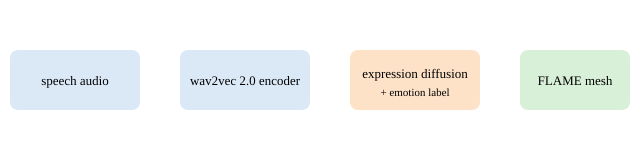

# EmoTalk-Lite: 음성 기반 감정 표정 생성

음성과 감정 레이블을 입력으로 받아 3D 얼굴 표정 계수(FLAME expression)를 생성하는 연구 프로젝트입니다.

## 구성
- 방법 설명: [method](docs/method.md)
- 관련 연구 정리: [related work](docs/related_work.md)
- 학습 코드: `src/train.py` (모델은 `src/model.py`, 데이터는 `src/data.py`)
- 평가 코드: `src/evaluate.py`, 결과는 [experiments/results.md](experiments/results.md)
- 전체 구조 그림: 
- 논문 초안: `paper/draft.pdf`

## 실행
```
python src/train.py --config configs/base.yaml
python src/evaluate.py --ckpt runs/best.pt
```
